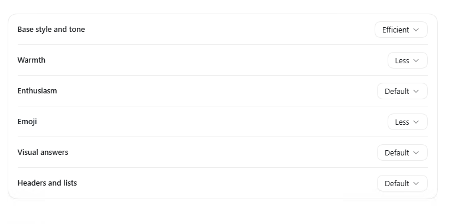
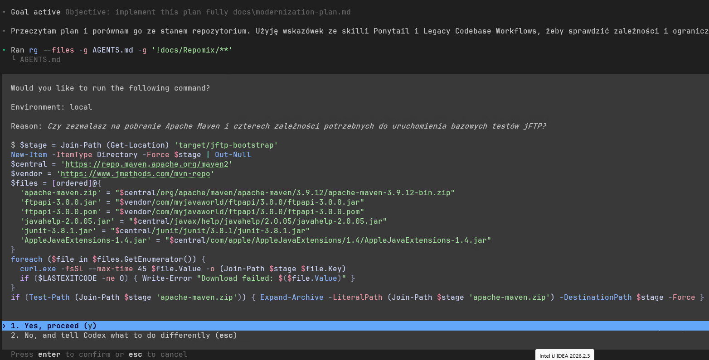

# Historia czatu — dzień 2, 19 listopada 2026

Wiadomości publiczne w kolejności chronologicznej. Reakcje oznaczają zliczenia przy wiadomościach, nie rozłączne głosy ani liczbę uczestników.

## Wiadomości

- **09:02 — Łukasz Matuszewski:** NA start praca z legacy w jFTP:  
  https://devpowers.com/szkolenia/jsystems/codex-java-2026-11/Prezentacja_07_Legacy.html#1

- **09:06 — Łukasz Matuszewski:** Po problemie z Sandboxem i niestandardowym folderze CODEX_HOME:  
  Stop-Service -Name 'CodexSandboxService.OpenAI.Codex' -ErrorAction Stop & 'D:\AI\[dane usunięte]\bin\codex\codex.exe' sandbox uninstall

- **09:13 — Łukasz Matuszewski:** https://repomix.com/  
  Kompresja kodu

- **09:17 — Łukasz Matuszewski:** https://aider.chat/docs/repomap.html  
  Mapa kodu - symbole z całego repo w jednym pliku

- **09:18 — Łukasz Matuszewski:** Grafy kodu - połączenia w aplikacjach  
  https://github.com/Graphify-Labs/graphify

- **10:32 — Łukasz Matuszewski:** Chciałbym, żebyś tutaj tą repomapę razem z wszystkimi artefaktami dodał do folderu docs w folderze Repomap. Zrób. Wydaje mi się, że w instrukcjach tego skilla powinno być to opisane, jak powinieneś robić. Sprawdź, czy tam takie instrukcje się znajdują i dlaczego je zignorowałeś, jeżeli się znajdują. Bo wydaje mi się, że powinna być tam instrukcja, że powinieneś zapisywać to w folderze docs. Artefakty powinny być w folderze artefakt z kropką na początku i one zwykle powinny być do .gitignore'a dodane. Natomiast w tym wypadku możemy je też skomitować ze względu na to, że jesteśmy na szkoleniu, żeby to po prostu było widoczne. Natomiast ten plik z mapą może być jakby w katalogu głównym, od razu docsów, czyli w folderze docs bezpośrednio, tak żeby od razu było widać, że ta mapa tam jest, a artefakty do tej mapy po prostu w dedykowanym folderze dla tej mapy.

- **10:32 — Łukasz Matuszewski:** Chciałbym, żebyś w kolejnym kroku zrobił również Repomix, żebyśmy zobaczyli, czym on się różni od Repomapy. No i również zrób to już w folderze docs.

- **10:32 — Łukasz Matuszewski:** Stwórz teraz jeszcze skompresowaną wersję repomixa bez komentarzy.

- **10:34 — Łukasz Matuszewski:** Chciałbym, żebyś teraz zrobił graf kodu. Wybierz jedną z metod, tam masz dwie. No i chciałbym, żebyś zrobił nam też wizualizację, więc podaj mi linka, gdzie mogę obejrzeć ten graf wizualnie.

- **11:12 — Łukasz Matuszewski:** Koniec przerwy 11:30

- **11:39 — Łukasz Matuszewski:** Suba agenci custom przez nas skonfigurowani:  
  https://github.com/LucasMatuszewski/jsystems-codex-java-2026-11/tree/main/course-materials/agent-configs/codex/agents

- **11:48 — Łukasz Matuszewski:** Spec Driven Development:  
  Spec Kit  
  https://github.com/github/spec-kit

- **11:49 — Łukasz Matuszewski:** Spec, m.in. FIRE  
  https://specs.md/

- **11:56 — Łukasz Matuszewski:** Skills do SDD:  
  https://www.skills.sh/?q=spec  
  https://www.skills.sh/?q=prd  
  https://www.skills.sh/?q=adr  
  https://www.skills.sh/?q=plan

- **12:19 — Łukasz Matuszewski:** https://platform.openai.com/tokenizer  
  Tokenizer

- **12:22 — Łukasz Matuszewski:** OpenAI's large language models process text using tokens, which are common sequences of characters found in a set of text. The models learn to understand the statistical relationships between these tokens, and excel at producing the next token in a sequence of tokens.

- **12:30 — Łukasz Matuszewski:** Be casual, not formal, but still professional.  
  Be concise! Provide short answers unless I ask for more details. I prefer step-by-step instructions that are straight to the point. Never repeat the same information.  
  You may provide your opinions on topics but always make it clear that this is your opinion, not a fact. When you don't know, just say that you don't know.

- **12:30 — Łukasz Matuszewski:** AGENTS.md

- **12:32 — Łukasz Matuszewski:** Chat in Polish unless the user requests another language. Application documentation, comments and code uses English. Your internal thoughts always in English.

- **12:48 — Łukasz Matuszewski:** Jira i Pamięć dla agentów:  
  https://github.com/gastownhall/beads

- **12:52 — Łukasz Matuszewski:** DB Dolt = MySQL + Git  
  https://github.com/dolthub/dolt

- **12:54 — Łukasz Matuszewski:** 

- **12:54 — Łukasz Matuszewski:** Base style and tone  
  Warmth  
  Enthusiasm  
  Emoji

- **12:56 — Łukasz Matuszewski:** Do optymalizacji zużycia tokentów skills:  
  https://www.skills.sh/juliusbrussee/caveman/caveman

- **12:56 — Łukasz Matuszewski:** https://github.com/juliusbrussee/caveman

- **13:00 — Łukasz Matuszewski:** https://www.skills.sh/dietrichgebert/ponytail/ponytail

- **13:01 — Łukasz Matuszewski:** https://github.com/dietrichgebert/ponytail

- **13:03 — Łukasz Matuszewski:** npx skills add https://github.com/dietrichgebert/ponytail --skill ponytail

- **13:04 — Łukasz Matuszewski:** PS C:\Users\[dane usunięte]> cd D:\jftp\  
  PS D:\jftp> npx skills add https://github.com/dietrichgebert/ponytail --skill ponytail

- **13:10 — Łukasz Matuszewski:** Koniec przerwy 13:40

- **14:28 — Łukasz Matuszewski:** Peter LEvels - praca na servwerze PHP na prod bezpośrednio z agentami:  
  https://x.com/levelsio

- **14:52 — Łukasz Matuszewski:** Checklisty i TODO po szkoleniu + tabela decyzyjna gdzie dodać jaką instrukcję:  
  https://devpowers.com/szkolenia/jsystems/codex-java-2026-11/checklisty.html#harness

- **14:54 — Łukasz Matuszewski:** CLI  
  /resume - poprzednie sesje

- **15:05 — Łukasz Matuszewski:** /voice

- **15:07 — Łukasz Matuszewski:** https://handy.computer/  
  Dyktowanie komend gdziekolwiek

- **15:08 — Łukasz Matuszewski:** https://github.com/cjpais/Handy

- **15:10 — Łukasz Matuszewski:** Dla polskiego model STT:  
  Canary 1B v2

- **15:13 — Łukasz Matuszewski:** $legacy-codebase-workflows I would like you to create an architecture UML diagrams here using Mermaid and a fragment of a skill that I've attached.

- **15:14 — Łukasz Matuszewski:** https://www.skills.sh/spillwavesolutions/design-doc-mermaid/design-doc-mermaid

- **15:15 — Łukasz Matuszewski:** https://github.com/SpillwaveSolutions/design-doc-mermaid  
  UML archutektury - wykresy Mermaid bardzo fajne

- **15:16 — Łukasz Matuszewski:** Fragmen mojego skills do Legacy:  
  https://github.com/EdukeyTeam/agent-toolbox/blob/main/skills/legacy-codebase-workflows/references/architecture-diagrams.md

- **15:20 — Łukasz Matuszewski:** $write-adr Using all the information you already have on this application, create architectural documentation in the form of an ADR that describes the state of the application.

- **15:21 — Łukasz Matuszewski:** AGENTS.md  
  https://devpowers.com/szkolenia/jsystems/codex-java-2026-11/Prezentacja_04_Workflow.html#4

- **15:28 — Łukasz Matuszewski:** https://modelcontextprotocol.io/docs/2026-07-28/getting-started/intro  
  MCP = standard dostarczania narzędzi dla agentów

- **15:29 — Łukasz Matuszewski:** https://modelcontextprotocol.io/docs/2026-07-28/develop/build-server  
  Własne servery MCP

- **15:39 — Łukasz Matuszewski:** 2x esc = tryb transkrypcji w CLI

- **15:40 — Łukasz Matuszewski:** strzałki na boki - nasze prompty historia

- **15:40 — Łukasz Matuszewski:** enter = rewind = cofnięcie prompta

- **15:43 — Łukasz Matuszewski:** $legacy-codebase-workflows Write characterization tests and regression tests for code that already exists based on your knowledge of this code.

- **15:49 — Łukasz Matuszewski:** https://github.com/LucasMatuszewski/jsystems-codex-java-2026-11/blob/main/course-materials/Prompt%20examples/Legacy-Code-JFTP-modernization.md  
  Modernizacja Legacy - prompt przykładowy

- **15:50 — Łukasz Matuszewski:** when we do the refactor, regardless of the implementation change, the test should still pass if the functionality works.  
  Try to run this application with minimal changes. Introduce such changes that will be minimally needed for this application to start at the beginning.  
  After the minimum startup and after the minimum changes needed to run this application, of course check whether the tests still pass. If they do not pass, you must fix something in the application and check whether this functionality was actually broken. Focus on fixing the code, not on fixing the tests. Assume initially that your modified code is wrong, not the tests.

- **15:50 — Łukasz Matuszewski:** At the moment when the application is being launched, and we have tests passing, in such a minimal version, after a minimal refactor of this application, you should make granular commits and move on to the proper larger refactor, updating the versions of various dependencies and also updating the code itself to newer Java standards, so that it is implemented in accordance with the latest guidelines related to Java and modern standards.

- **15:53 — Łukasz Matuszewski:** ctrl + g  
  domyślny edytor ustawiony w zmiennej:  
  $EDITOR=micro

- **15:55 — Łukasz Matuszewski:** https://micro-editor.github.io/  
  Prosty edytor kodu TUI idealny do terminala i promptów

- **15:57 — Łukasz Matuszewski:** ctrl + g  
  modyfikacje  
  ctrl + s = save  
  ctrl + q = quit

- **15:59 — Łukasz Matuszewski:** /goal implent this plan @path/to/plan.md

- **15:59 — A.G.:** Musz się zwijać, dzięki za spotkanie

- **16:01 — Łukasz Matuszewski:** Podsumowanei i historia czata z wczoraj:  
  https://github.com/LucasMatuszewski/jsystems-codex-java-2026-11/tree/main/course-materials/zoom-summary-chat-history

- **16:03 — Łukasz Matuszewski:** Czyli dla wersji frameworków czy języka zwykle bezpiecznie jest dać jedną wersję wstecz, która już jest w bazie treningowej agentów, ale jeżeli chcemy używać najnowszej wersji, to po prostu musimy dać mu dokumentację. Jutro się tym zajmiemy i użyjemy sobie Context7 właśnie do dokumentacji.

- **16:04 — Łukasz Matuszewski:** Moje odpowiedzi na pytania agenta:  
  • Questions 3/3 answered  
  • Which Java line should the modernization target after the startup baseline is green?  
  answer: Java 25 LTS (Recommended)  
  • How far should this refactor go if the publisher has no newer compatible release of the FTP library?  
  answer: Preserve FTP compatibility (Recommended)  
  • Which platforms should gate completion of the modernization?  
  answer: Windows first (Recommended)

- **16:06 — Łukasz Matuszewski:** Questions 1/1 answered  
  • Can the modernization retire the separate browser applet entry point? The packaged application launches through a different desktop entry point.  
  answer: Retire applet (Recommended)

- **16:09 — Łukasz Matuszewski:** shift+tab  
  Plan mode  
  lub /plan

- **16:11 — Łukasz Matuszewski:** W trybie planu nie zapisał planu w pliku, musiałem wyjść z trybu planu i poprosić go aby zapisał w /docs/plan-file-name.md

- **16:11 — Łukasz Matuszewski:** Contex7 = dużo mniej tokenów zużywa niż web search

- **16:12 — Łukasz Matuszewski:** lazygit TUI

- **16:13 — Łukasz Matuszewski:** jest już commit zrobiony z planem, więc robię nową sesję:  
  /new

- **16:15 — Łukasz Matuszewski:** /goal implement this plan fully docs\modernization-plan.md  
  Pokaże się:  
  Goal active Objective: implement this plan fully docs\modernization-plan.md

- **16:17 — Łukasz Matuszewski:** Mimo użycia "Approve for me" agent oceniający zablokował instalację Maven i plan by się beze mnie nie wykonał, więc na początku realizacji planu lepiej zwykle poczekać chwilę i zobaczyć czy wszystko idzie ok.

- **16:18 — Łukasz Matuszewski:** 

## Lista zadań na jutro

Łukasz Matuszewski · 16:33–17:07

- analiza sesji z tworzenia planu w trybie planowania wbudowanym (np. brak zapisanego pliku z planem, brak użycia context7, brak delegowania do sub-agentów)
- konieczność wyjścia z trybu planowania aby zapisać plik z planem
- commit planu, review planu (z agentami albo z zespołem, sprawdzenie spójności docs).
- /new + wykonanie planu z /goal i jak działa cel
- konieczność monitorowania na starcie realizacji, często na początku błędy popełnia
- Niedoskonałość "Approve for me" w Codex do pracy autonomicznej (dużo częściej Was pyta niż Claude) - wymusza to używania "Allow all" albo... Claude ;)
- Pokazać, że przeczytał RepoMap na starcie (bardzo mało kontekstu to zajęło)
- Sprawdzenie wykonania, screens, Computer Use i Manual QA agenta
- Usuwanie pliku z Planem po jego realizacji (zostaje w git), lub jego archiwizacja (np. do /docs/plans/.archive) - pliki dokumentacji ADR, PRD, RepoMap, RepoMix zostają na stałe - plany są tymczasowe i się dezaktualizują
- Konieczność aktualizacji RepoMap, RepoMix, Grafów itp. po wprowadzeniu zmian.
- Poprawić docs na Angielski (zanim dodaliśmy instrukcję w AGENTS.md tworzył je po Polsku)
- konfiguracja glab i gh z personal access token
- wypchnięcie zmian
- PR robiony przez agenta + screenshots aplikacji
- Code Review w GH w chmurze (automat, podobnie GitLab w chmurze) - konfiguracja w Codex Code Review online
- Code Review w GitLab on premisses - konfiguracja workflow PR Agent lub codex cli
- dostęp w Codex/ChatGPT do GitLab on premisses przez Connector online (sprawdzić czy już działą Code Review, czy tylko dostęp do PR i commitów?)
- Monitor - wznawianie sesji agenta na wydarzenia, np. o określonej godzinie gdy się limit odnowi, lub po wykonaniu build
- Schedule vs Cron - odpalanie agenta ~5-6:00 rano aby uruchomił okno limitu 5h
- Hooks i permissions, custom provider profiles + alias (np. Ollama, OpenRouter, Z.ai)
- analiza kosztów sesji / użytkownika ze skillem do analizy
- Opcjonalnie: Context7 z custom RAG lokalnym z Legacy skill (agent ma pełną instrukcję w Skillu, wystarczy zapytać)
