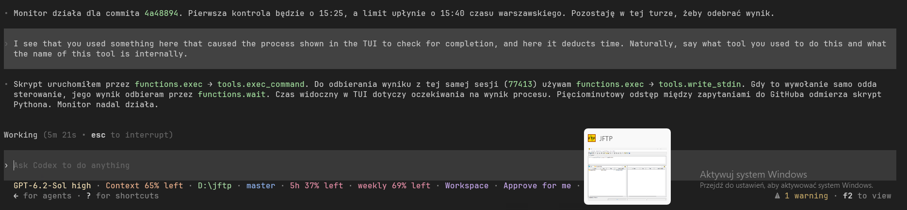
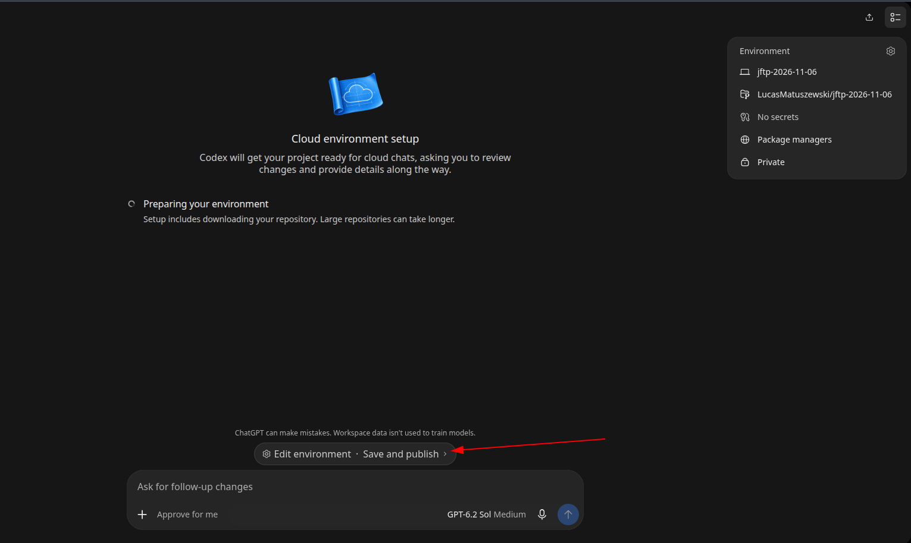
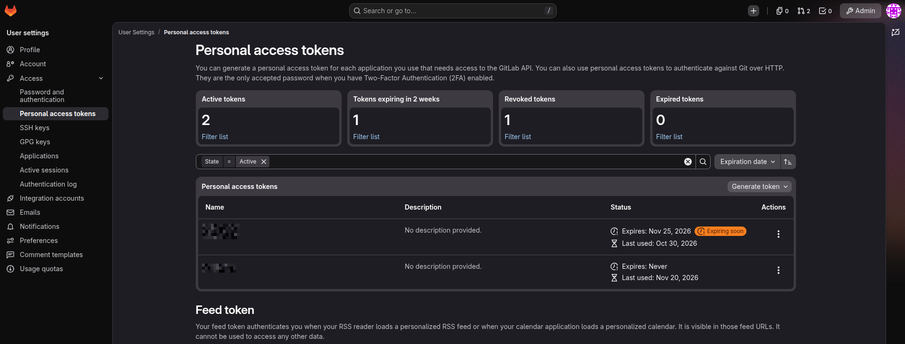

# Historia czatu — dzień 3, 20 listopada 2026

Wiadomości publiczne w kolejności chronologicznej. Reakcje oznaczają zliczenia przy wiadomościach, nie rozłączne głosy ani liczbę uczestników.

## Wiadomości

- **09:33 — Łukasz Matuszewski:** Tryb headless CLI agentów:

- **09:33 — Łukasz Matuszewski:** PS C:\Users\[dane osobowe]> codex exec --trust --skip-git-repo-check "hi what model are you?"  
  OpenAI Codex v0.170.0  
  --------  
  workdir: C:\Users\[dane osobowe]  
  model: gpt-6.2-sol  
  provider: openai  
  approval: never  
  sandbox: workspace-write [workdir, /tmp, $TMPDIR]  
  reasoning effort: medium  
  reasoning summaries: none  
  session id: 01a1f815-52aa-7740-8a2d-7e1f4e92a797  
  --------  
  user  
  hi what model are you?  
  codex  
  Jestem Codex, asystentem opartym na GPT‑6.  
  tokens used  
  8238  
  PS C:\Users\[dane osobowe]> codex exec --trust --skip-git-repo-check --json "hi what model are you?"  
  {"type":"thread.started","thread_id":"01a1f815-ecab-7531-b276-6d449d3f6c6e"}  
  {"type":"turn.started"}  
  2026-11-20T08:32:30.171201Z ERROR codex_memories_write::phase2: Phase 2 no changes  
  {"type":"item.completed","item":{"id":"item_0","type":"agent_message","text":"Cześć! Jestem Codex, oparty na GPT‑6."}}  
  {"type":"turn.completed","usage":{"input_tokens":23448,"cached_input_tokens":15232,"cache_write_input_tokens":0,"output_tokens":20,"reasoning_output_tokens":0}}

- **09:33 — Łukasz Matuszewski:** claude -p "prompt"

- **09:34 — Łukasz Matuszewski:** OpenCode  
  https://opencode.ai/

- **09:35 — Łukasz Matuszewski:** Pi  
  https://pi.dev/

- **09:37 — Łukasz Matuszewski:** Narzędzia gdzie można użyć usbskrypcji Codex/ChatGPT:  
  https://v0.app/ - vibe coding / UI

- **09:38 — Łukasz Matuszewski:** https://hermes-agent.nousresearch.com/

- **09:39 — Łukasz Matuszewski:** https://openclaw.ai/

- **09:39 — Łukasz Matuszewski:** Autonomiczni agenci

- **09:40 — Łukasz Matuszewski:** OpenAI ma też agenta Dot  
  https://openai.com/pl-PL/index/introducing-dots/

- **09:58 — Łukasz Matuszewski:** Contex7 - do dokumentacji  
  https://context7.com/

- **10:18 — Łukasz Matuszewski:** codex doctor  
  codex doctor --json  
  diagnostyka codexa w razie problemów

- **10:18 — Łukasz Matuszewski:** ! codex doctor

- **10:26 — Łukasz Matuszewski:** npx ctx7 setup --codex

- **10:27 — Łukasz Matuszewski:** code D:\AI\[dane osobowe]\.codex\

- **10:33 — Łukasz Matuszewski:** Configs przykładowe dla Codex:  
  https://github.com/LucasMatuszewski/jsystems-codex-java-2026-11/tree/main/course-materials/agent-configs/codex

- **10:41 — Łukasz Matuszewski:** Kolejny przykład config.toml  
  https://github.com/LucasMatuszewski/jsystems-codex-java-2026-11/blob/main/.codex/config.toml

- **10:42 — Łukasz Matuszewski:**

  approvals_reviewer = "auto_review" # Route eligible approval requests to the reviewer agent.
  approval_policy = "on-request"
  # approval_policy controls when Codex asks before it runs tools/commands.
  # CLI override example:
  #   codex --config 'approval_policy="on-request"'
  #
  # approval_policy = "never"      # Never ask; actions requiring approval are rejected, not automatically allowed.
  # "untrusted" is no longer supported as an approval_policy value (use "on-request" or "never").
  #
  # Example granular approval policy:
  # approval_policy = { granular = {
  #   sandbox_approval = true,
  #   rules = true,
  #   mcp_elicitations = true,
  #   request_permissions = false,
  #   skill_approval = false
  # } }

- **10:48 — Łukasz Matuszewski:** Add a custom config.toml for Codex here at the project level, in which we will set a higher threshold for compacting the context window.  
  model_auto_compact_token_limit = 900000

- **10:50 — Łukasz Matuszewski:** codex mcp login context7

- **10:51 — Łukasz Matuszewski:** npx ctx7 setup

- **10:51 — Łukasz Matuszewski:** npx ctx7 setup --codex

- **11:00 — Łukasz Matuszewski:** env_http_headers = { "CONTEXT7_API_KEY" = "CONTEXT7_API_KEY" }

- **11:00 — Łukasz Matuszewski:** env_http_headers = [credential-redacted]

- **11:02 — Łukasz Matuszewski:** [mcp_servers.context7]  
  url = "https://mcp.context7.com/mcp"  
  env_http_headers = { "CONTEXT7_API_KEY" = "CONTEXT7_API_KEY" }

- **11:03 — Łukasz Matuszewski:**

  # Local MCP server with Context7 on your machine
  # [mcp_servers.context7]
  # command = "npx"
  # args = ["-y", "@upstash/context7-mcp", "--api-key", "YOUR_API_KEY"]
  # startup_timeout_sec = 20

- **11:11 — Łukasz Matuszewski:** I've already set auth here, so you should have access to Context7. Check if it works with a search engine. However, I would like to see instructions added here at the permanent project level in AGENTS.md, so that every time we search for information about documentation in any tools or in the source code of our project's dependencies, the agent should first search for it in Context7 and not search the internet with a normal web search until it makes sure there is no information in Context7, because Context7 usually provides shorter information and is much slower and less accurate.  
  For local CLI tools, the first step, even better than Context7, is to use the built-in help. If an agent needs information about a local CLI, for example, GH or GitLab, it should use the help command. This is the first place the agent should look for information about commands or flags for that CLI. Second, it should search Context7, and only as a last resort, search the internet if it cannot find the information using these first 2 m

- **11:13 — Łukasz Matuszewski:** Koniec przerwy 11:30

- **11:32 — Łukasz Matuszewski:** System Linux fajny dla pracy z Agentami:  
  https://omarchy.org/

- **11:54 — Łukasz Matuszewski:** Setting ChatGPT plugins:  
  https://chatgpt.com/settings/plugins-settings

- **12:03 — Łukasz Matuszewski:** Własne MCP / Connectors / Apps / Plugins:  
  https://modelcontextprotocol.io/docs/2026-07-28/develop/build-server

- **12:04 — Łukasz Matuszewski:** https://developers.openai.com/plugins/build/plugins

- **12:05 — Łukasz Matuszewski:** https://learn.chatgpt.com/docs/extend/mcp?surface=cli

- **12:07 — Łukasz Matuszewski:** GitHub MCP Server official  
  https://github.com/github/github-mcp-server

- **12:14 — Łukasz Matuszewski:** ctrl + j = nowa linia  
  \ + enter = nowa linia

- **12:16 — Łukasz Matuszewski:** https://github.com/github/github-mcp-server  
  I would like to connect the GitHub MCP server with my personal token, a more granular one, not through OAuth, but through the token I'll provide here. I'd like you to help me configure it. I want it to be able to add new repositories, because I'll want to create a new repository here, but it should have limited access to the rest of the things. Of course, I'd also like it to handle pull requests and work with commits and pushes. But other things should be blocked because we won't use most of them. So help me choose the right options here, and also help me configure this MCP locally.

- **12:18 — Łukasz Matuszewski:** https://github.com/settings/credentials  
  Credentials -> PAT Personal Access Token

- **12:19 — Łukasz Matuszewski:** Fine Grained  
  https://github.com/settings/personal-access-tokens/new

- **12:25 — Łukasz Matuszewski:** [dane usunięte] grants you 5 permissions for all repositories:  
  ActionsRead-only  
  AdministrationRead and write  
  ContentsRead and write  
  MetadataRead-only  
  Pull requestsRead and write

- **12:29 — Łukasz Matuszewski:** Read access to actions and metadata  
  Read and Write access to code, pull requests, and repository creation

- **12:29 — Łukasz Matuszewski:** Zamiast ADMIN:  
  repository creation

- **12:32 — Łukasz Matuszewski:** $env:JFTP_GITHUB_MCP_PAT = Read-Host 'GitHub fine-grained PAT' -MaskInput

- **12:42 — Łukasz Matuszewski:** https://docs.gitlab.com/user/model_context_protocol/mcp_server/

- **12:59 — Łukasz Matuszewski:** Emotional Prompting:  
  https://prompt-guide.com/en/glossaire/emotional-prompting-definition-and-examples  
  https://community.openai.com/t/emotional-prompting-encouraging-gpt/317900/8

- **13:05 — Łukasz Matuszewski:** When we do the refactor, regardless of the implementation change, the test should still pass if the functionality works.  
  Try to run this application with minimal changes. Introduce such changes that will be minimally needed for this application to start at the beginning.  
  After the minimum startup and after the minimum changes needed to run this application, of course check whether the tests still pass. If they do not pass, you must fix something in the application and check whether this functionality was actually broken. Focus on fixing the code, not on fixing the tests. Assume initially that your modified code is wrong, not the tests.

- **13:05 — Łukasz Matuszewski:** At the moment when the application is being launched, and we have tests passing, in such a minimal version, after a minimal refactor of this application, you should make granular commits and move on to the proper larger refactor, updating the versions of various dependencies and also updating the code itself to newer Java standards, so that it is implemented in accordance with the latest guidelines related to Java and modern standards.

- **13:07 — Łukasz Matuszewski:** I would like to be included in this plan. I would delegate all activities to subagents each time. The agent implementing this plan should focus on coordinating the work and checking its quality. On the other hand, each task should be delegated to the subagent using the model best suited to that task. It could be Sol, Astra, or Luna. Astra, of course, only in extreme cases for very difficult tasks. Luna would be best for exploration, reading files, and research, while Sol would be best for generating code.

- **13:09 — Łukasz Matuszewski:** To explore, you can also use an external agent from OpenCode, i.e., the OpenCode CLI, which you should use in headless mode. I would like you to add instructions for the managing orchestrator agent on how to use OpenCode in headless mode and how to set up the Xiaomi MiMo Pro model there. MiMo-V2.6-Pro

- **13:10 — Łukasz Matuszewski:** For most tasks, you shouldn't use Git worktrees. Git worktrees are only needed when several agents have to work on the same files, so only in extreme cases. In most situations, Git worktrees shouldn't be used. Agents should have their work divided so that they can perform some activities simultaneously while having a specific scope, i.e., a folder in which to work, so that their scopes simply don't require them to work on the same files. Alternatively, one agent can perform quality assurance, i.e., run tests, while another writes code. This can also be done in parallel if needed, but without using Git worktrees unless necessary.

- **13:12 — Łukasz Matuszewski:** Before starting implementation, you should also check for consistency between the instructions in the AGENTS files, the project documentation in the PLD files, ADRs, and architecture descriptions, and this plan. Check whether there is any contradictory information, conflicting instructions, or unclear or inconsistent information across these sources. Before we launch this plan, the whole thing should be reviewed to ensure there are no doubts about any of its elements.

- **13:16 — Łukasz Matuszewski:** Make sure you committed this plan. Then I would like you to create a new skill based on this history, this session, my comments on the plan you created, and what we did. In the future, this will allow us to create these plans more as I would like, without using planning mode. This information about how the plan should be created should be included in a skill for agents. It should also contain information about where such a file should be written. By default, it should be written in the DocsPlans folder so that it does not interfere with the implementation of this plan in the future.

- **13:20 — Łukasz Matuszewski:** subagenci Codex CLI:  
   Interacted with `/root/plan_update`  
  Completed `/root/plan_update`  
  W statusline pojawia się:  
   Main [default]

- **13:20 — Łukasz Matuszewski:** /subagents - podgląd co robią subagenci

- **13:24 — Łukasz Matuszewski:** I forgot about one more important element that you should include both in the plan you created and in the skill you created. You should create temporary briefs in the briefs folder for use while implementing tasks here with agents, subagents, and CLI agents. For example, when delegating to OpenCode, you should write prompts as Markdown brief files. Then, when delegating to a subagent here in the code or to an agent through OpenCode in headless mode, you should refer to this file and tell the agent to simply implement the instructions in it.  
  After approving the implementation plan, when you cancel the file with the plan, you should also cancel the briefs concerning it. These briefs should ideally be assigned to the plan they concern, if they concern it, because they will not always concern the plan.

- **13:26 — Łukasz Matuszewski:** /new - nowa sesja

- **13:27 — Łukasz Matuszewski:** /goal implement this plan fully: @docs\modernization-plan.md

- **13:28 — Łukasz Matuszewski:** Koniec przerwy 14:00

- **13:30 — Łukasz Matuszewski:** the path to briefs could be /docs/.briefs/<plan-name>  
    
  Where did you saved this skill? I want it on project level in .agents/skills, not in your .codex/skills folder.

- **13:37 — Łukasz Matuszewski:** zwykle domyślnie zapisze w .codex/skills na poziomie usera:  
  Pierwszą wersję zapisałem w D:\AI\[dane osobowe]\.codex\skills. Przeniosę ją do D:\jftp\.agents\skills\write-implementation-plan

- **13:37 — Łukasz Matuszewski:** Koniec przerwy 14:00

- **13:40 — Łukasz Matuszewski:** I want you to commit the briefs, so they should not get gitignored. They should be removed after the plan is completed, but they should also be committed during the plan realization when orchestrator creates these briefs.

- **13:44 — Łukasz Matuszewski:** The briefs should include all the instructions for the subagents / CLI agents needed to complete the task, so that they should not need to make any important decisions or read the docs. Especially smaller LLMs like Luna needs very detailed instructions that they should follow.

- **13:44 — Łukasz Matuszewski:** Plan should also not duplicate detailed information from PRD, ADR, and other Docs. They are source of truth and plan should point to them for more details.  
  But them plan may provide the info about the workflow that is described in AGENTS.md file so that orchestrator will follow this workflow.

- **13:44 — Łukasz Matuszewski:** Koniec przerwy 14:00

- **14:12 — Łukasz Matuszewski:** Moje repo jFTP:  
  https://github.com/LucasMatuszewski/jftp-2026-11-06

- **14:12 — Łukasz Matuszewski:** branch z planem:  
  https://github.com/LucasMatuszewski/jftp-2026-11-06/tree/docs/modernization-plan

- **14:12 — Łukasz Matuszewski:** Nowy skill do tworzenia planów:  
  https://github.com/LucasMatuszewski/jftp-2026-11-06/tree/docs/modernization-plan/.agents/skills/write-implementation-plan

- **14:13 — Łukasz Matuszewski:** inne skills do planowania:  
  https://www.skills.sh/?q=plan

- **14:14 — Łukasz Matuszewski:** https://www.skills.sh/addyosmani/agent-skills/planning-and-task-breakdown

- **14:16 — Łukasz Matuszewski:** TODO: template planu w skill

- **14:20 — Łukasz Matuszewski:** /fork = pełna kopia sesji  
  /btw = tymczasowy fork z historią sesji na pytania poboczne (nie przerywając pracy agenta)

- **14:22 — Łukasz Matuszewski:** https://git-scm.com/docs/git-worktree  
  Git Worktree = branch z kopią kodu

- **14:27 — Łukasz Matuszewski:** TODO:  
  All worktrees should always be written inside the project folder, in a folder called .worktrees, and inside this folder you should add a worktree,  
  ALBO:  
  All git Worktrees should be created in a folder next to the project with the same name as the main project, but with the -worktrees postfix.

- **15:02 — Łukasz Matuszewski:** automatyczne odpowiedzi agenta lokalnego na CR do jego PR:  
  https://github.com/EdukeyTeam/agent-toolbox/tree/main/skills/respond-to-code-review

- **15:02 — Łukasz Matuszewski:** $respond-to-code-review

- **15:03 — Łukasz Matuszewski:** /rename - zmiana nazwy sesji

- **15:05 — Łukasz Matuszewski:** Testy QA:  
  Desktop - computer use  
  Web - Playwright CLI / MCP

- **15:09 — Łukasz Matuszewski:** Automatyzacja w kartach dowolnych, również Waszych np. strony Banku itp gdzie user wcześniej się zalogował wymagają wtyczki i wyższych uprawnień:  
  https://chromewebstore.google.com/detail/playwright-extension/mmlmfjhmonkocbjadbfplnigmagldckm

- **15:12 — Łukasz Matuszewski:** Chrome DevTools MCP/CLI  
  https://github.com/ChromeDevTools/chrome-devtools-mcp  
  Może używać trybu debuggowania, ale dostaje pełen dostęp do wszystkich kart i danych Chrome:  
  https://github.com/ChromeDevTools/chrome-devtools-mcp/blob/main/docs/advanced-usage.md#automatically-connecting-to-a-running-chrome-instance

- **15:19 — Łukasz Matuszewski:** You should check here automatically after 5 minutes if new comments were added, but you didn't set up any monitor or script that would free you after 5 minutes and instruct you to check those comments again. So explain to me why, because it seems to me that the skill I used here to answer the Pull Request had an instruction to monitor whether new comments appeared. To do that, you should create a script that would, for example, trigger you after 5 minutes, or trigger you every 5 minutes to check if such a comment was created. You should turn off this script only when, in this shell, in your background, such a comment is created and you answer it. You should also add a maximum number of calls, for example, 20 minutes.

- **15:24 — Łukasz Matuszewski:** Monitor działa dla commita 4a48894. Pierwsza kontrola będzie o 15:25, a limit upłynie o 15:40 czasu warszawskiego. Pozostaję w tej turze, żeby odebrać wynik.  
  I see that you used something here that caused the process shown in the TUI to check for completion, and here it deducts time. Naturally, say what tool you used to do this and what the name of this tool is internally.  
  Skrypt uruchomiłem przez functions.exec → tools.exec_command. Do odbierania wyniku z tej samej sesji (77413) używam functions.exec → tools.write_stdin. Gdy to wywołanie samo odda sterowanie, jego wynik odbieram przez functions.wait. Czas widoczny w TUI dotyczy oczekiwania na wynik procesu. Pięciominutowy odstęp między zapytaniami do GitHuba odmierza skrypt Pythona. Monitor nadal działa.

- **15:24 — Łukasz Matuszewski:** 

- **15:36 — Łukasz Matuszewski:** https://tailscale.com/  
  własna VPN do podpięcia dodatkowych urządzeń, np. laptopa, komórki, VPS do wspólnej sieci

- **15:43 — Łukasz Matuszewski:** 

- **15:44 — Łukasz Matuszewski:** ChatGPT Cloud Environments:  
  https://learn.chatgpt.com/docs/environments/cloud-environments

- **15:53 — P.:** Cześć, ja muszę lecieć niestety. Dzięki za szkolenie

- **15:54 — Łukasz Matuszewski:** .codex/rules/<name>.rules

- **15:54 — Łukasz Matuszewski:** https://github.com/LucasMatuszewski/jsystems-codex-java-2026-11/tree/main/course-materials/agent-configs/codex/rules

- **15:55 — Łukasz Matuszewski:** pattern=[["git", "git.exe"], "push", ["origin", "upstream"], ["main", "master", "prod"]]

- **15:56 — Łukasz Matuszewski:** prefix_rule(pattern=[["git", "git.exe"], "push", ["origin", "upstream"], ["main", "master", "prod"]], decision="forbidden", justification="Block explicit protected branches on the course remotes; refspec destinations are not token-prefix matches.", match=["git push origin main", "git.exe push upstream master", "git push origin prod"], not_match=["git push origin feature/example", "git push origin HEAD:main", "git push"])

- **15:57 — Łukasz Matuszewski:** prefix_rule(pattern=["pwd"], decision="allow", justification="Print the current directory.", match=["pwd"], not_match=["cat README.md"])

- **16:00 — Łukasz Matuszewski:** https://ankiety.jsystems.pl/

- **16:01 — Łukasz Matuszewski:** CODEX_HOME

- **16:02 — Łukasz Matuszewski:** Codex z innymi providerami:  
  Aliasy:  
  https://github.com/LucasMatuszewski/jsystems-codex-java-2026-11/blob/main/course-materials/agent-configs/codex-aliases.ps1

- **16:02 — Łukasz Matuszewski:** alias codexz='codex --profile zai'  
  alias cdxz='codex --profile zai'  
  alias cdxor='codex --profile openrouter'  
  alias cdxoc='codex --profile ollama-cloud'  
  alias cdxlfm='codex --profile ollama-lfm'  
  alias cdxsql='codex --profile ollama-sql'  
  alias cdxgemma='codex --profile ollama-gemma'

- **16:02 — Łukasz Matuszewski:** https://github.com/LucasMatuszewski/jsystems-codex-java-2026-11/blob/main/course-materials/agent-configs/.bashrc-agents

- **16:04 — Łukasz Matuszewski:** Profiles dla providerów:  
  https://github.com/LucasMatuszewski/jsystems-codex-java-2026-11/blob/main/course-materials/agent-configs/codex/config.toml#L134

- **16:05 — Łukasz Matuszewski:** Przykłady CI/CD dla Gitlab i Codex i innych  
  https://github.com/LucasMatuszewski/jsystems-codex-java-2026-11/tree/main/course-materials/cicd-headless

- **16:06 — Łukasz Matuszewski:** PR Agent  
  https://github.com/LucasMatuszewski/jsystems-codex-java-2026-11/tree/main/course-materials/cicd-headless/PR-Agent-Qodo  
  https://github.com/The-PR-Agent/pr-agent

- **16:06 — Łukasz Matuszewski:** Podsumowanei Zoom dodam tutaj:  
  https://github.com/LucasMatuszewski/jsystems-codex-java-2026-11/tree/main/course-materials/zoom-summary-chat-history

- **16:07 — Łukasz Matuszewski:** Osoby do śledzenia:  
  https://github.com/LucasMatuszewski/jsystems-codex-java-2026-11/blob/main/course-materials/Course%20INDEX%20-%20AI%20in%20Programming.md#people-and-accounts-to-follow-in-ai

- **16:08 — Łukasz Matuszewski:** Contex7 RAG na własnym kodzie czy dokumentacji:  
  https://github.com/EdukeyTeam/agent-toolbox/tree/main/skills/legacy-codebase-workflows/assets/context7  
  skill legacy ma pełne instrukcje:  
  https://github.com/EdukeyTeam/agent-toolbox/tree/main/skills/legacy-codebase-workflows

- **16:12 — Łukasz Matuszewski:** W GitLab Self-Managed Personal Access Tokens ustawicie tutaj:  
  https://<URL_HOSTA>/-/user_settings/personal_access_tokens?state=active&sort=expires_asc

- **16:15 — Łukasz Matuszewski:** 

- **16:15 — Łukasz Matuszewski:** Avatar > Preferences > Access > PAT

- **16:16 — Łukasz Matuszewski:** do użycia w MCP lub CLI GitLab

- **16:16 — Łukasz Matuszewski:** https://docs.gitlab.com/user/model_context_protocol/mcp_server/

- **16:17 — Łukasz Matuszewski:** https://docs.gitlab.com/cli/

- **16:29 — Łukasz Matuszewski:** BEZPIECZEŃSTWO:  
    
  Sandbox  
  elevated, unelevated, MXC, Allow All  
    
  Permissions  
  Mało inteligentne, ale działają deterministycznie.  
  Można tworzyć własne profile oprócz domyślnych, na różne sytuacje (są dostępne na liście w GUI i TUI)  
  Mogą być w config.toml lub wyodrębnione do: .codex/permissions.toml  
  Przykład: https://github.com/LucasMatuszewski/jsystems-codex-java-2026-11/blob/main/course-materials/agent-configs/codex/permissions.toml  
  Opis / instrukcja: https://github.com/LucasMatuszewski/jsystems-codex-java-2026-11/blob/main/course-materials/agent-configs/codex/PERMISSIONS.md  
    
  Rules  
  bardziej szczegółowe, elastyczne  
  działają w trybie Approve for me  
  dodaj w .codex/rules/<name>.rules  
  przykład: https://github.com/LucasMatuszewski/jsystems-codex-java-2026-11/blob/main/course-materials/agent-configs/codex/rules/course.rules  
    
  Hooks:  
  Dowolne czynności na eventach w Codex SDK livecycle  
  Np. start sesji, użycie bash  
  przykłady we repo macie: https://github.com/LucasMatuszewski/jsystems-codex-java-2026-11/tree/main/course-materials/hooks-example
